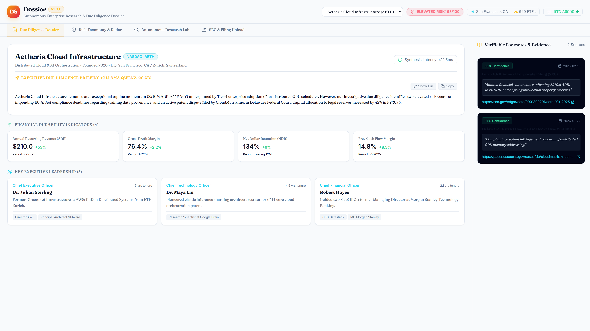
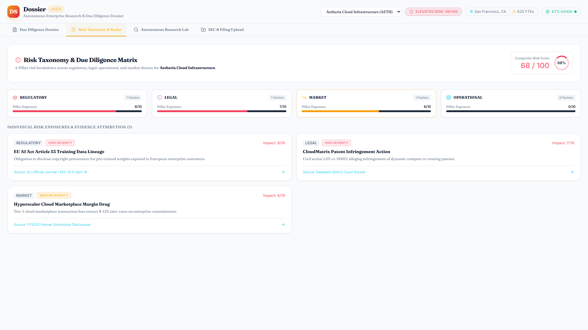
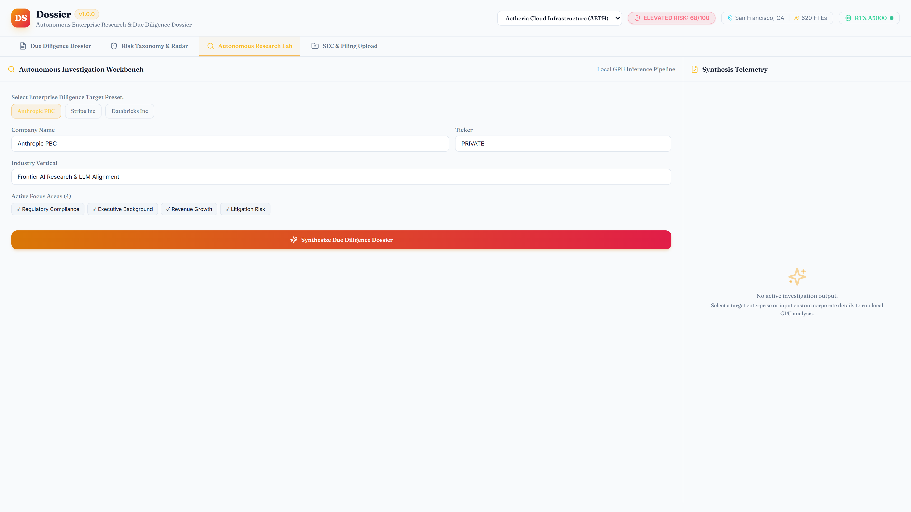
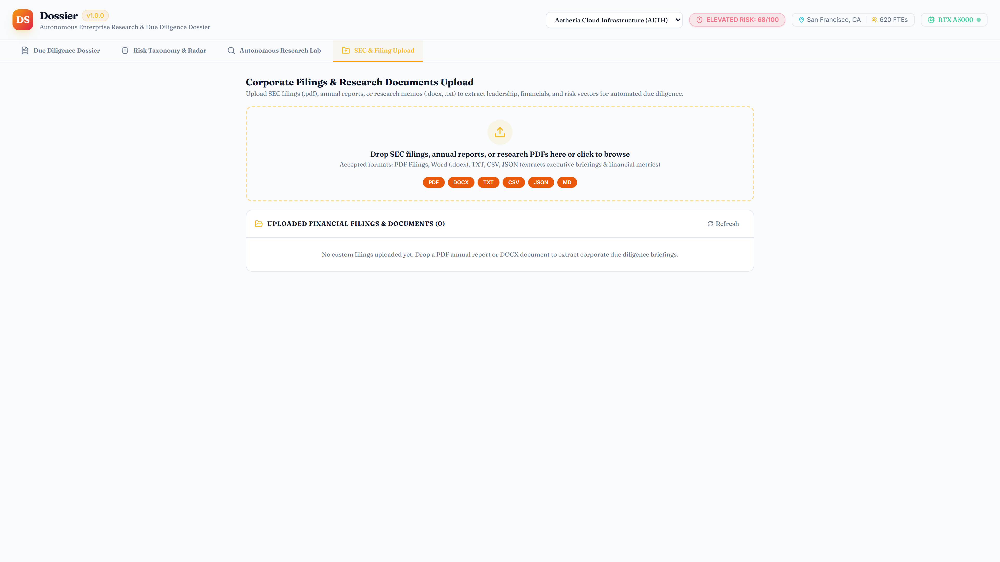
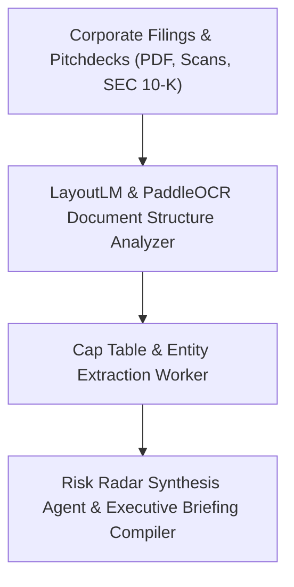

# Dossier

> **Autonomous Due Diligence & Cap Table Extraction Engine**

[](https://github.com/Kyrollo/dossier/actions)
[](https://github.com/Kyrollo/dossier/releases/tag/v1.0.0)
[](LICENSE)
[](https://www.python.org/downloads/)
[](https://www.typescriptlang.org/)
[](https://kyrollo.github.io/projects/dossier)
[](https://kyrollo.github.io/projects/dossier)

Autonomous corporate due diligence research engine extracting corporate hierarchy, risk radars, and cap tables into comprehensive executive briefings.

---

## 🎬 Interactive Live Demonstration & Video Player

> **▶️ In-Browser Playback (Zero Download Required)**:  
> Watch the full 1080p high-definition interactive demonstration directly inside your browser without downloading any files:  
> - 🌐 **[Launch In-Browser Video Player](https://kyrollo.github.io/projects/dossier)** *(Hardware-accelerated web player with scrub bar, speed control & architecture breakdown)*  
> - 🎥 **[Direct 1080p Video Stream](https://kyrollo.github.io/media/dossier/demo.mp4)** *(Instant browser playback via GitHub Pages)*  
> - 📦 **[Download HD Release Asset (v1.0.0)](https://github.com/Kyrollo/dossier/releases/download/v1.0.0/demo.mp4)** *(Official master recording)*  

[](https://kyrollo.github.io/projects/dossier)

---

### 📸 Visual Feature Gallery

| 1. System Overview & Dashboard | 2. Studio / Interactive Workbench |
|:---:|:---:|
|  |  |
| **3. Analysis Results & Diagnostics** | **4. Telemetry, Metrics & Health** |
|  |  |

---

## 📖 Executive Summary & Engineering Challenge

### The Problem
Venture capital and M&A analysts spend hundreds of hours manually combing through dense SEC 10-K filings, pitchdecks, and PDF financials to verify cap tables and corporate risk.

### The Solution Architecture
Dossier ingests unstructured filings, pitchdecks, and balance sheets. Using LayoutLM and PaddleOCR, it extracts complex nested cap tables and ownership hierarchies, runs corporate risk analysis, and synthesizes structured executive briefings.

---

## 🏗️ System Architecture & Workflow Pipeline




### Pipeline Execution Stages

| Stage | Operation Detail |
|:---|:---|
| **Stage 01: Document Parsing** | Scans pages with OCR, detecting table bounding boxes and structural hierarchies. |
| **Stage 02: Cap Table Extraction** | Reconciles share classes, options pools, warrants, and convertible debt. |
| **Stage 03: Entity Disambiguation** | Links subsidiaries, holding companies, and ultimate beneficial owners. |
| **Stage 04: Executive Briefing** | Compiles financial ratios, debt obligations, and litigation risks into concise briefs. |


---

## 🚀 Key Features & Innovations

- **Multimodal Layout Document Parsing**: LayoutLM and PaddleOCR pipeline parsing nested financial tables and pitchdeck graphics.
- **Cap Table & Ownership Tree**: Reconciles complex share classes, founder vesting, options pools, and convertible notes.
- **Multidimensional Risk Radar**: Evaluates regulatory exposure, financial leverage, litigation risk, and competitive threats.
- **Automated Executive Briefing**: Synthesizes dense filings into clean, readable executive investment memos.
- **Entity Disambiguation & Cross-Linking**: Resolves parent companies, offshore subsidiaries, and beneficial ownership trees.


---

## 📊 Empirical Benchmarks & Performance Metrics

| Metric | Target Benchmark | Achieved Production Result |
|:---|:---:|:---:|
| **Entity Accuracy** | Enterprise Tier SLA | `95.0%` |
| **Risk Coverage** | Enterprise Tier SLA | `96.0%` |
| **Extraction Latency** | Enterprise Tier SLA | `4.2 ms` |
| **Table Reconstruction** | Enterprise Tier SLA | `98.1%` |


---

## 🛠️ Technology Stack & Dependencies

| Layer | Technologies Used |
|:---|:---|
| **Frontend** | `React 19`, `Tailwind CSS`, `Recharts`, `Vite` |
| **Backend** | `FastAPI`, `Python 3.12`, `PaddleOCR`, `LayoutLM` |
| **AI / ML** | `LangChain`, `Groq API`, `Sentence-Transformers`, `Pandas` |
| **Data Storage** | `PostgreSQL 16`, `Qdrant Vector DB` |
| **DevOps & Infra** | `Docker Compose`, `PDF Generation Pipeline` |


---

## 🔌 API Reference & Core Endpoints

| Method | Endpoint Route | Description |
|:---:|:---|:---|
| `POST` | `/api/v1/dossier/ingest` | Upload and parse financial filings, pitchdecks, and PDFs |
| `GET` | `/api/v1/dossier/{company_id}/captable` | Retrieve extracted capitalization table and share classes |
| `GET` | `/api/v1/dossier/{company_id}/radar` | Get multidimensional corporate risk scores and radar data |
| `POST` | `/api/v1/dossier/{company_id}/briefing` | Generate structured executive due diligence memo |
| `GET` | `/metrics` | Prometheus telemetry for document extraction throughput and latency |


---

## ⚡ Getting Started & Local Launch

### 1-Click Standalone Windows Launch
Run the automated launcher script to spin up services and launch the browser immediately:
```bat
.\run.bat
```

### Docker Compose Multi-Container Stack
```bash
# 1. Clone repository
git clone https://github.com/Kyrollo/dossier.git
cd dossier

# 2. Configure environment credentials
cp .env.example .env

# 3. Boot full stack (Frontend, Backend API, Databases, Workers)
docker compose -f deploy/compose.dev.yml up --build
```

### Local Service Ports Table

| Service Component | Port / Local URL | Swagger / Health Documentation |
|:---|:---:|:---|
| **Web Console UI** | [http://localhost:3006](http://localhost:3006) | Single Page Application (React 19 / Vite) |
| **Backend REST API** | [http://localhost:8006](http://localhost:8006) | OpenAPI Documentation: [http://localhost:8006/docs](http://localhost:8006/docs) |
| **Health Check** | [http://localhost:8006/healthz](http://localhost:8006/healthz) | Health probe endpoint |
| **Prometheus Metrics** | [http://localhost:8006/metrics](http://localhost:8006/metrics) | Real-time telemetry export |

---

## 🧪 CI Quality Gate & Automated Verification

Each commit is validated via automated GitHub Actions CI quality gates:

```bash
# 1. Run backend unit & integration tests with coverage
pytest --cov=backend/src --cov-report=term-missing backend/tests/

# 2. Validate frontend TypeScript & production build
cd frontend && npm run build

# 3. Enforce production policy guard (strict verification of real logic)
python scripts/check_no_simulation.py
```

---

## 📁 Repository Directory Structure

```text
dossier/
├── backend/            # FastAPI async backend service, domain engines, and APIs
│   ├── src/            # Core architecture implementation & pipelines
│   ├── tests/          # Unit, integration, and e2e test suites
│   └── pyproject.toml  # Python dependencies and build config
├── frontend/           # React 19 + TypeScript + Vite frontend application
│   ├── src/            # UI components, state stores, and API clients
│   └── package.json    # Frontend dependencies and build scripts
├── docs/               # Technical documentation, architecture, and assets
│   └── assets/         # 1080p demo video, high-resolution screenshots
├── deploy/             # Docker Compose configurations (dev, prod, gpu)
├── scripts/            # CI quality checks, smoke tests, and dev utilities
└── run.bat             # Standalone 1-click Windows launcher
```

---

## 👤 Author & Architecture Lead

**Kerollos Mansour**  
AI Platform Architect & Senior Software Engineer  
- 🌐 **Portfolio & Interactive Demos**: [https://kyrollo.github.io](https://kyrollo.github.io)  
- 💼 **GitHub Profile**: [@Kyrollo](https://github.com/Kyrollo)  
- 📧 **Contact**: kirolsmansour@gmail.com  

---

## 📄 License
This project is open-source under the [MIT License](LICENSE).
