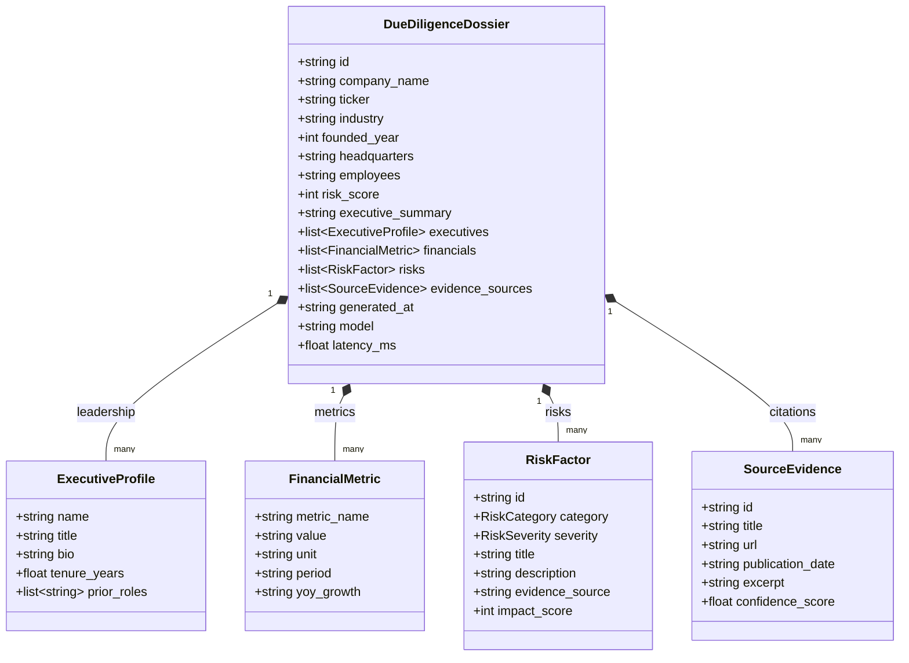

# Dossier Data Model

This document outlines the domain entities, relationships, and data structures utilized by Dossier for corporate due diligence and autonomous intelligence synthesis.

---

## 1. Domain Entity Relationship Diagram

---

## 2. Enums and Classification

### RiskCategory
- `REGULATORY`: Cross-jurisdictional compliance, EU AI Act, GDPR, SEC disclosures.
- `LEGAL`: Intellectual property lawsuits, patent litigation, active court dockets.
- `MARKET`: Cloud marketplace take-rates, margin compression, pricing pressure.
- `OPERATIONAL`: Infrastructure dependencies, key personnel reliance, cluster outages.
- `FINANCIAL`: Debt covenants, customer concentration, burn rate.

### RiskSeverity
- `HIGH`: Major regulatory action, federal lawsuit, or existential market disruption (Weight: 28).
- `MEDIUM`: Operational friction, margin compression, or compliance audit overhead (Weight: 14).
- `LOW`: Routine supplier dependency or manageable talent turnover (Weight: 6).
